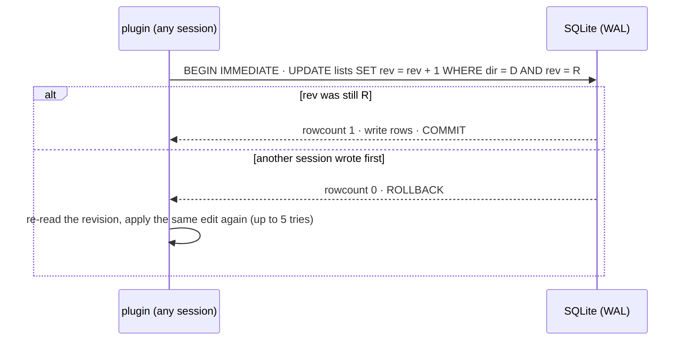
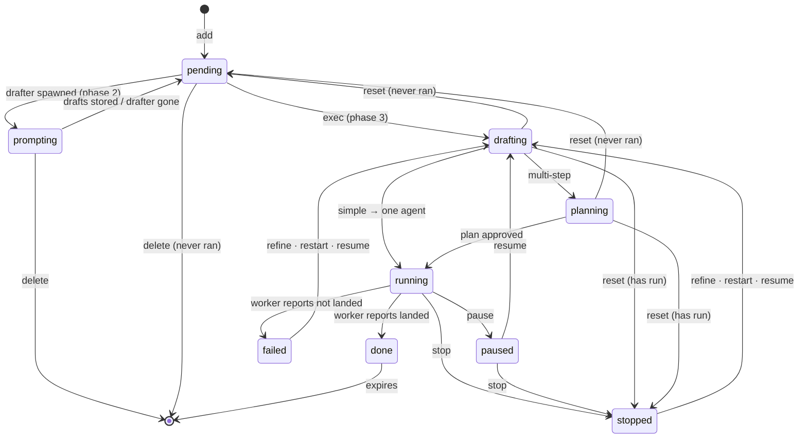

# Architecture

hermes-todo is a native Hermes plugin that keeps a per-repo backlog of todos
that Hermes agents run: each todo works in its own git worktree, lands as one
commit, and every status move it may make is guarded by one table. It is a
port of claude-todo's spec (docs/architecture.md there) to the Hermes plugin
surface; the spec is ported, not the code.

## The pieces

| Piece | Role | Source |
|---|---|---|
| Registration | Registers the `todo_*` tools on the plugin's `todo` toolset | `__init__.py` |
| Tools | `todo_add`, `todo_backlog`, `todo_update` — what the LLM calls; JSON answers, errors included, never a raise | `tools.py`, `schemas.py` |
| Store | One SQLite database (WAL) per Hermes profile, lists keyed by repo, revision-guarded writes | `db.py` |
| Contract | The transitions table every status write passes, and its guard | `transitions.json`, `transitions.py` |

Later phases add: the drafter (`ctx.llm` structured call on add/rename),
the exec runner (`ctx.subagent_lifecycle.launch` with the ported protocol
prompt, worktree per todo, linking via `correlation_id`), call tracing
(`pre_tool_call` / `post_tool_call`), takeover reconcile on session end, and
the TUI pane (ambient rail card + modal).

## Where state lives

| State | Where | Why there |
|---|---|---|
| Todos | One SQLite database from `plugin_db("hermes-todo")` — `<hermes home>/plugin-data/hermes-todo/data.db`, WAL — keyed by the repo the session is in (each worktree is its own repo; outside a repo, the home directory) | Shared by every session on the machine; survives restarts, updates and removals |
| The list's revision | A `lists` row per repo directory | The revision guard (below) |
| Runtime session state | `ctx.state` (phase 3+: drafts in flight, prompt handoffs) | Belongs to one session |

## Writing without losing edits

Sessions share the database file, so each write says which revision of the
list it was computed from:

A write beaten five times raises `GiveUp`; the tool answers with the error
and never claims the add. The one-script-per-process constraint of
claude-todo disappears (Python holds the connection), but the revision
guard stays: sessions still share the file, and `BEGIN IMMEDIATE` plus the
guarded rev bump makes a lost update impossible.

## A todo's life

A todo is always in one of nine states; `transitions.json` is the one table
of the moves it may make, and `Store.update` is the one guard every status
write passes. A move the table doesn't allow writes nothing — not the other
fields of the same report either — and answers with the moves that are
allowed. Python imports the JSON directly, so there is no mirror to
regenerate; a test drives every `(from, to)` pair through the store and
checks the guard follows the table exactly.

| State | Meaning | Who moves it on |
|---|---|---|
| prompting | Its drafter is writing prompt drafts, so nothing may start it yet (phase 2) | The drafter's drafts or its end |
| pending | Ready to run | You, via exec (phase 3) |
| drafting | The prompt is being written or refined | The worker, via `todo_update` |
| planning | Multi-step: plan being settled | The worker, via `todo_update` |
| running | An agent is working in its worktree | The worker's report once it ends |
| paused | Halted with its run kept, so resume picks up where it was | You |
| stopped | Halted for good; its worktree and branch are kept | You |
| done | Landed (or committed, with no remote) | Expires after the keep period |
| failed | Finished without landing; its worktree and branch are kept | You |

`todo_update` marks a todo run (`has_run`) the first time it turns running,
stamps `done_at` once when it turns done, and stores the prompt, mode, task
and run ids, summary, branch and landed hash as they become known. A done
todo leaves the list after its keep period (`HERMES_TODO_DONE_TTL_MINUTES`,
default 5 minutes; 0 keeps); a failed one stays.

## The tools

| Tool | Does | Refuses with |
|---|---|---|
| `todo_add {title}` | Adds a pending todo, returns its number | Usage, when the title is empty |
| `todo_backlog {} | The repo's backlog as JSON (after expiring done todos) | — |
| `todo_update {n, …}` | Reports prompt/mode/status/summary/branch/landed/task ids through the guard | The refusal naming the allowed moves; `no todo #n`; usage without a number |

Every tool answers a JSON string, errors included, and never raises into the
host.

## Landing (phase 3, spec already fixed)

Each todo works on its own branch in its own worktree, commits as it goes,
and lands on the base branch as one squashed commit, rebased onto whatever
other todos landed meanwhile and checked again — never force-pushed; a
conflict that can't be resolved with confidence aborts the rebase, pushes
nothing and fails the todo, keeping its branch. The landing message reads
`<area>: <imperative>` (72 columns at most) followed by the why, the checks,
and `Todo: #N`. The protocol prompt (the launch goal text) carries these
rules verbatim from claude-todo's `hooks/protocol.ts`.

## Divergences from claude-todo (deliberate)

- The plugin launches the worker itself (`ctx.subagent_lifecycle.launch`);
  there is no prompt-submit machinery to route work through the chat, so the
  `Queued`/held-prompt states of claude-todo have no analog.
- Answers are JSON (the Hermes tool convention), not plain text.
- The transitions table is read straight from `transitions.json`; the TS
  mirror (`hooks/transitions.ts`) and its regeneration script don't exist
  here. The TLC model check stays a dev-time option in the claude-todo repo;
  the table is the same one.
- The store is the profile's `plugin_db` database, not one file per repo
  directory; lists are rows keyed by repo path.
