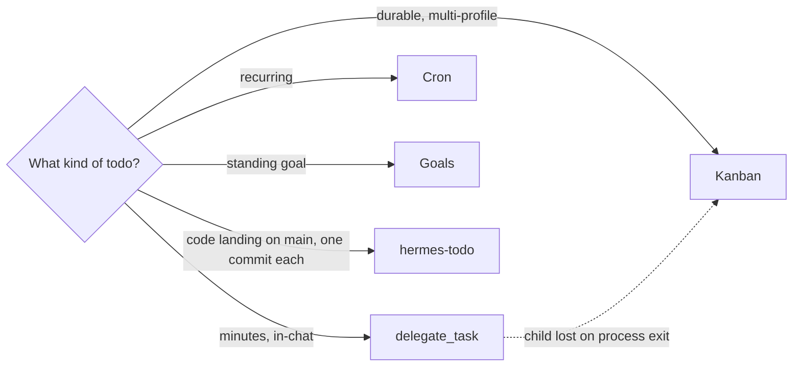
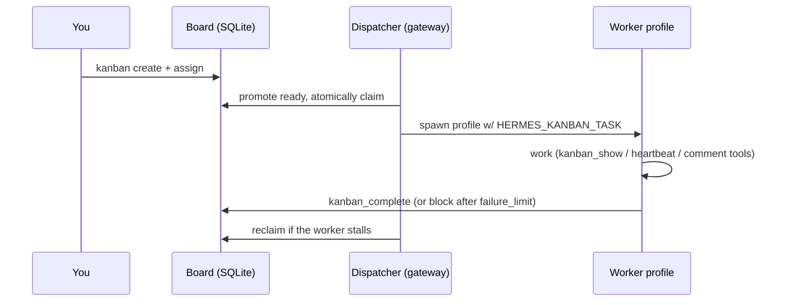
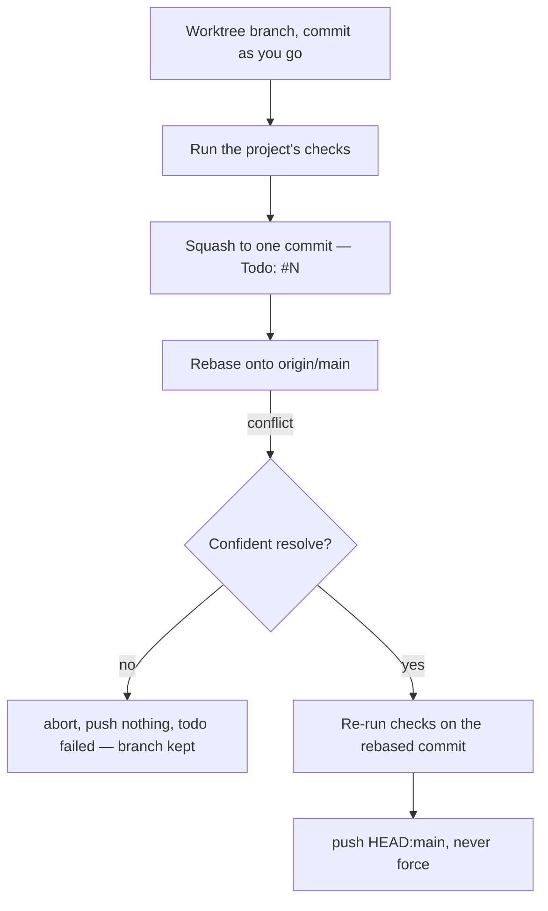
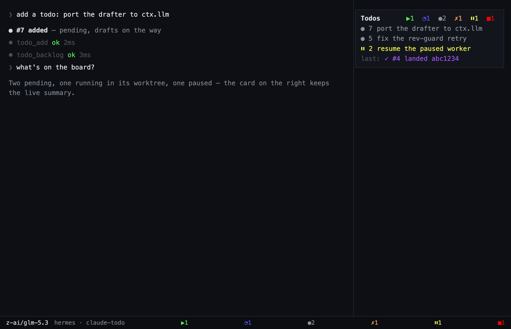
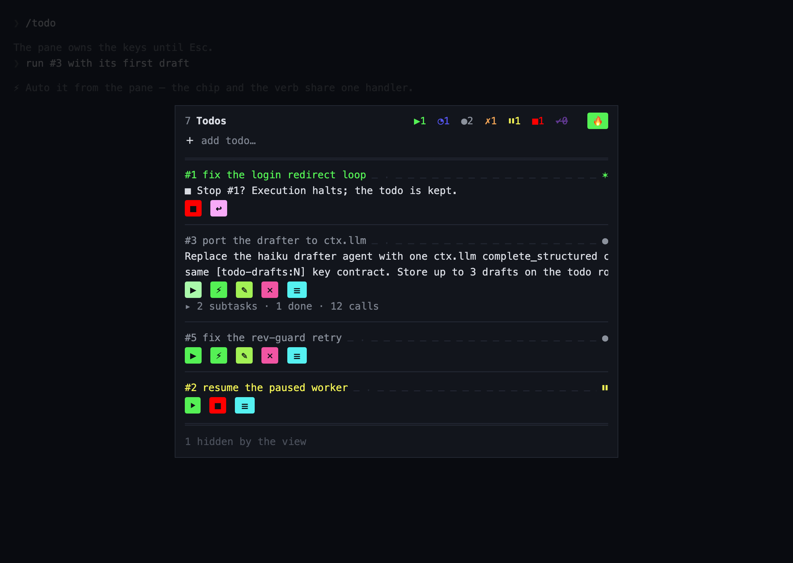
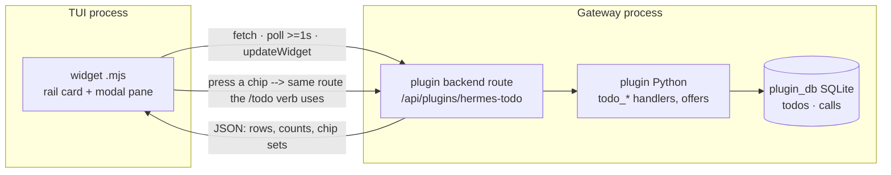

# Orchestrating todos with Hermes — the field guide

How to drive todo-style work with stock Hermes, and where the `hermes-todo`
plugin (the claude-todo port) slots in. Grounded in the Hermes source and
background-systems docs; the port's plan lives in the claude-todo repo at
`tmp/plans/migrate-hermes.md`.

## Pick the right tool

| Workload | Use | Why |
|---|---|---|
| Quick parallel subtasks (minutes, this session) | `delegate_task` | In-process children, isolated contexts; batch capped by `delegation.max_concurrent_children` (default 3) |
| Work that must survive restarts / span profiles | **Kanban board** | Durable SQLite; dispatcher spawns workers, reclaims stale claims |
| Recurring or scheduled ("every Monday 9am") | **Cron** | Durable scheduler, per-job skills/model/workdir, script-only mode |
| One standing goal, keep going till done | **Persistent Goals** | The Ralph loop across turns |
| Hours-long interactive missions | Spawned `hermes` processes (tmux, `-w`) | Fully independent process, full tool access |
| Repo todos landing as one commit each, guarded states | **hermes-todo plugin** (this port, phase 1 done) | The claude-todo workflow, native |



## 1. Parallel batch — `delegate_task`

Fire independent research/writing/coding subtasks in one call; results
re-enter the conversation as turns.

```
delegate_task(tasks=[
  {goal: "Audit hooks/db.ts for SQL injection", context: "Repo: claude-todo"},
  {goal: "Port docs/test-cases.md rows M1-M7 to pytest names"},
  {goal: "Check competitor kanban tooling", context: "See tmp/plans/migrate-hermes.md"}
])
```

- `background=true` → handle now, result arrives as a new turn later.
- `leaf` (default) can't re-delegate; `orchestrator` spawns its own workers
  (bounded by `delegation.max_spawn_depth`).
- **Not durable** — a backgrounded child is process-local; if the parent
  process exits, the child is lost. Durable work goes to kanban or cron.

## 2. Durable board — Kanban

The multi-agent work queue: tasks live in SQLite, a dispatcher inside the
gateway promotes ready tasks, atomically claims them and spawns the
assigned profile per task.

```bash
hermes kanban init
hermes kanban create "Port the transitions guard" --assign coder
hermes kanban create "Write Phase 2 tests" --assign reviewer
hermes kanban ls && hermes kanban tail <task>
hermes kanban complete <task>   # workers do this via kanban_complete
```



- Worker toolset is gated by `HERMES_KANBAN_TASK`; the board is the hard
  isolation boundary, tenants a soft namespace within it.
- Cross-gateway: one dispatcher, profile-owned delivery.
- `watch` / `stats` / `runs` for observability; `gc` and `archive` for hygiene.

## 3. Repo work — worktrees, then land

Multiple agents editing one repo safely: each gets its own checkout
(`hermes -w`, or `working_directory` on a subagent launch). The landing
discipline the hermes-todo port enforces:



## 4. Where hermes-todo slots in

Stock kanban has no enforced state machine, no per-todo worktree/landing
rules, no exec-prompt protocol — that's what `hermes-todo` adds on top of
the same primitives:

| claude-todo feature | Hermes primitive it rides |
|---|---|
| per-repo SQLite backlog, rev-guarded writes | `plugin_db` store (shipped, phase 1) |
| 9-state machine, guarded transitions | `transitions.json` + guard (shipped, phase 1) |
| drafter agent per add | `ctx.llm.complete_structured` (shipped, phase 2) |
| worker per todo in a worktree | `ctx.subagent_lifecycle.launch` + `working_directory` (shipped, phase 3) |
| per-call tracing | `pre/post_tool_call` hooks, process-global, fire in children (shipped, phase 4) |
| exec from an idle session | `ctx.inject_message` (consented `allow_gateway_injection`) |
| toasts back into the chat | `ctx.post_message` |
| the pane | dashboard route (`dashboard/plugin_api.py`) + TUI widgets in `widgets/` (shipped, phase 5 — the TUI-mode data seam stays open, below) |

## 5. The pane — how the TUI integration and display work

hermes-todo's display is a **TUI widget app**: a plain `.mjs` file dropped
in `~/.hermes/tui-widgets/`, hot-reloaded on save, no build step, no JSX
(`h()` from the `sdk` parameter). It ships as **two surfaces** over one
`defineWidgetApp`:

```js
export default function register(sdk) {
  const { defineWidgetApp } = sdk
  defineWidgetApp({
    id: 'todo',            // doubles as the slash command: /todo
    mode: 'modal',         // the pane (below); the card is a second app
    help: 'the todo pane',
    init: arg => ({ ... }), reduce: ..., render: ...,
  })
}
```

### The two surfaces

| Surface | Mode | Does |
|---|---|---|
| Rail card | `ambient`, `zone: 'top-right'`, explicit `width` (~44 cols), ~6 rows | The tree's summary: per-status counts with marks, the lowest-numbered pending todo, latest activity line. Click-only — ambient captures no keys. Auto-opens via `sdk.openWidget` |
| The pane | `modal`, opened by `/todo` | Owns every keypress until Esc: the real tree with focus ring, one-row chip sets per state, confirmation lines (focus on the safe choice), the details dialog and the call browser over recorded calls |

**The rail card** — ambient, docked in the TUI's right rail beside the
transcript; the status bar keeps the same counts while the card is closed:



**The pane** — modal, opened by `/todo`; it shows the tree with the focus
ring, one-row chip sets per state, a Stop confirmation (question line above
its one row of choices, the ring on the safe choice), and the hidden-view
footer:



Both mockups use the real palette (statuses 30° apart round the wheel,
chips filled with the color of the status they move the todo into). The
sources live in `docs/mockups/*.html` — change them with the pane, and
re-render with `scripts/render-mockups.sh` (headless Chrome, 2× scale).

### The data path (the one seam that isn't a built-in yet)

The widget is JS in the **TUI process**; the store is SQLite owned by the
**Python plugin half in the gateway process**. Widgets' only I/O is `fetch`
(no imports), so the bridge is HTTP: the widget polls a plugin backend
route and lands results with `sdk.updateWidget` — which no-ops if the
widget is closed, so a late reply can never resurrect it.



The **open gap**: the `dashboard/plugin_api.py` route namespace
(`/api/plugins/<name>`) is served by `hermes dashboard` and the Desktop
app, not by a plain `hermes --tui` session. Options on the table: (a) ship
the Desktop pane first (its SDK has first-class backend REST), (b) have the
widget fetch a dashboard server that hermes-todo starts (or asks you to
start), (c) ask upstream for a plugin-served widget data route. This is
decided before phase 5 starts, not during.

### Display rules carried over from claude-todo's pane

- **One line per element, no blank lines anywhere**; the tree's rule lines
  (a double `═` under the header, a single `─` between todos) are the only
  separators.
- **Actions are one row of chips**, ordered carry-on → start-over →
  put-away/destroy → Details; a chip is offered only where it can act.
- **Focus never resizes an item** — Ink has no cheap "border swap" trick,
  so the ring brightens (`t.color` focus tone) instead of adding a border.
- **A card must never resize while ticking**: explicit `Dialog` width, pad
  dynamic numbers, constant row count per phase.
- **Colors are theme tones (`t.color.*`) only** — the widget must survive
  `/skin` and light/dark. claude-todo's raw-hex 30°-apart palette either
  becomes theme tones or the todo palette deliberately ignores skins.
- **Actions from the pane dispatch the same handlers as the `/todo` verbs**
  (the `offers()` pattern, ported): one code path for chips and typed
  verbs, so they can't drift.
- **Esc just closes the modal** and hands the keys back to the composer —
  Claude's two-stage Esc-handoff machinery doesn't exist here, which is a
  simplification.

### Verification (from the TUI contract)

`/widgets-reload` must list the file under `loaded:`; a thrown `register()`
is silently skipped — check `~/.hermes/logs/tui_gateway_crash.log` if a
widget never appears.

hermes-todo ships all of this (the plugin itself, the `/todo` verbs, the
dashboard route and the two widgets); the one seam still open is the widget
data path in plain `hermes --tui` mode, above. Until the upstream route
lands, kanban + `delegate_task` remain the stock fallback for surfaces the
pane can't reach.
